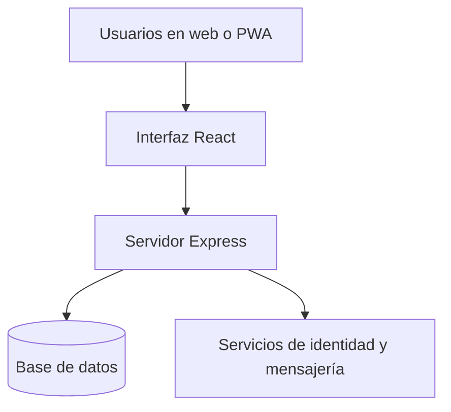

# 🌸 Kanban Colaborativo

**Organiza proyectos, colabora con tus amigos y mantén tus tareas al día.**

Kanban Colaborativo es una aplicación web **multiusuario y multiespacio**, diseñada para organizar proyectos en tableros visuales. Ofrece acceso privado por invitación, instalación como **Progressive Web App (PWA)** y notificaciones para acompañar el trabajo diario.

> **Estado del proyecto:** versión en preparación para su despliegue público. Algunas funciones, especialmente las notificaciones en dispositivos móviles, requieren validación en producción.

## ✨ Funcionalidades

| Funcionalidad | Descripción |
| --- | --- |
| 🔐 Acceso por invitación | Inicio de sesión mediante Google. La incorporación de nuevas personas está controlada por invitaciones. |
| 🌷 Varios Kanban | Una persona puede crear sus propios espacios y colaborar en los de otros usuarios. |
| 👥 Permisos por espacio | Cada usuario puede administrar su Kanban y participar como miembro en otro. |
| 🗂️ Tableros de proyectos | Tareas organizadas en **Por hacer**, **En progreso**, **En revisión** y **Finalizado**. |
| 🎯 Organización de tareas | Prioridades, responsables, fechas de entrega, etiquetas y subtareas. |
| 💌 Invitaciones | Incorporación de colaboradores mediante correo electrónico. |
| 🎨 Perfiles personalizables | Nombre visible, color e ícono de usuario. |
| 📱 Instalación PWA | Acceso desde la pantalla de inicio del teléfono o desde el escritorio. |
| 🔔 Notificaciones | Avisos por cambios de estado, tareas prioritarias y recordatorios de pendientes. |
| 🌙 Interfaz adaptable | Diseño responsive con temas claro y oscuro y estética kawaii. |

## 🧩 Tecnologías

- **Interfaz:** React, JavaScript, CSS, Axios y Lucide React.
- **Servidor:** Node.js y Express.
- **Persistencia:** MongoDB Atlas y Mongoose.
- **Identidad:** integración con Google.
- **Invitaciones:** integración con Gmail.
- **Aplicación instalable:** tecnologías PWA y Web Push.
- **Alojamiento previsto:** Vercel.

### Arquitectura general



La lógica de autorización se aplica en el servidor. Los proyectos y las tareas se consultan de acuerdo con la identidad de cada persona y sus permisos en el espacio seleccionado.

## 👥 ¿Cómo funcionan los Kanban?

Cada persona tiene una única cuenta y puede pertenecer a distintos espacios de trabajo. Por ejemplo, puede ser **administradora de su propio Kanban** y **miembro del Kanban de un amigo**.

Los proyectos permanecen separados por espacio. Las invitaciones permiten incorporar participantes sin abrir el acceso a todos los usuarios de Internet.

### Flujo de uso

1. Una persona autorizada accede a la aplicación.
2. Crea un proyecto dentro de su Kanban.
3. Invita a quienes colaborarán en ese proyecto.
4. El equipo organiza tareas, asigna responsables y actualiza su progreso.
5. Cada integrante puede configurar avisos para mantenerse al día.

## 📱 Aplicación PWA y recordatorios

La aplicación está pensada para usarse tanto desde el navegador como desde un acceso instalado en el teléfono o computador compatible.

Las opciones **«Instalar app»** y **«Activar avisos»** están disponibles en la sección **Aplicación** del menú lateral.

Los recordatorios de tareas pendientes admiten las siguientes preferencias:

| Preferencia | Comportamiento previsto |
| --- | --- |
| Cada 6 horas | Hasta tres avisos durante el día. |
| Cada 12 horas | Dos avisos diarios; opción predeterminada. |
| Cada 24 horas | Un aviso diario. |
| Desactivados | Sin recordatorios periódicos. |

También se contemplan avisos relacionados con cambios de estado y asignaciones prioritarias. Las notificaciones son opcionales y dependen de los permisos y la compatibilidad del dispositivo. Para consultar o modificar proyectos se necesita conexión a Internet.

## 💻 Desarrollo local

### Requisitos

- Node.js y npm.
- Acceso autorizado a los servicios externos utilizados por el proyecto.
- Configuración privada del entorno de desarrollo, distribuida por separado a las personas responsables.

### Instalar dependencias

Desde la carpeta del servidor:

```bash
npm install
```

Desde la carpeta de la interfaz:

```bash
npm install
```

### Iniciar el proyecto

En una terminal, dentro de la carpeta del servidor:

```bash
npm run dev
```

En otra terminal, dentro de la carpeta de la interfaz:

```bash
npm start
```

> La aplicación requiere una configuración local privada previa. Por seguridad, este README no incluye los parámetros internos de conexión ni instrucciones de gestión de accesos.

## ☁️ Despliegue

El repositorio está preparado para alojar la interfaz y el servidor en un mismo proyecto de Vercel. La configuración de despliegue está versionada en la raíz del repositorio.

La puesta en producción requiere configurar de forma privada las integraciones externas y verificar el funcionamiento de la aplicación en el dominio definitivo.

**Comprobaciones recomendadas después del despliegue:** acceso de usuarios invitados, aislamiento de espacios, creación y edición de tareas, instalación PWA y recepción de notificaciones en dispositivos reales.

## 🔒 Seguridad y privacidad

- El acceso está orientado a personas invitadas.
- La autorización de proyectos y espacios se valida del lado del servidor.
- Las preferencias de notificaciones son individuales.
- La aplicación no debe almacenar datos privados de proyectos en una caché pública compartida.
- Los elementos confidenciales de configuración se administran fuera del código fuente publicado.

**Importante:** la documentación pública describe el funcionamiento general del sistema. No reemplaza una auditoría de seguridad ni las comprobaciones necesarias antes de publicar la aplicación.

## 🧪 Pruebas

Dentro de la carpeta del servidor:

```bash
npm test
```

Dentro de la carpeta de la interfaz:

```bash
npm run build
```

Además, se recomienda comprobar con dos cuentas diferentes que un usuario pueda administrar su propio Kanban y participar en otro sin acceder a proyectos no autorizados.

## 📚 Referencias

- [React](https://react.dev/)
- [Node.js](https://nodejs.org/)
- [Express](https://expressjs.com/)
- [MongoDB](https://www.mongodb.com/)
- [MDN: Progressive Web Apps](https://developer.mozilla.org/en-US/docs/Web/Progressive_web_apps)
- [MDN: Push API](https://developer.mozilla.org/en-US/docs/Web/API/Push_API)
- [Vercel](https://vercel.com/docs)

---

*🌸 Organiza bonito. Avanza a tu ritmo. Colabora con tu equipo.*
