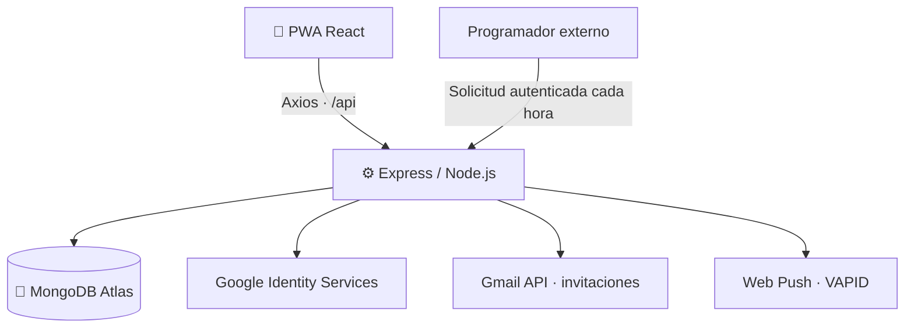

# 🌸 Kanban Colaborativo

**Tu espacio bonito para organizar proyectos, colaborar con amigos y avanzar sin olvidar las tareas importantes.**

Kanban Colaborativo es una aplicación web **multiusuario, multiespacio e instalable como PWA**, desarrollada con **React, Node.js, Express y MongoDB Atlas**. Permite trabajar con tableros Kanban privados, invitar colaboradores mediante Gmail y recibir notificaciones Web Push en dispositivos compatibles.

> **Estado:** aplicación en preparación para su primer despliegue de producción en Vercel. La configuración está incluida en el repositorio, pero las funciones de producción y los Push en teléfonos deben verificarse después de publicar.

## ✨ Funcionalidades

| Función | Descripción |
| --- | --- |
| 🔐 Acceso privado | Inicio de sesión con Google; las cuentas nuevas requieren una invitación previa, salvo la cuenta inicial autorizada mediante `ADMIN_EMAIL`. |
| 🌷 Múltiples Kanban | Cada usuario invitado puede crear sus propios espacios independientes y participar en los de otras personas. |
| 👥 Roles por espacio | Una persona puede ser **admin** de su Kanban y **member** en otro, sin tener permisos globales. |
| 🗂️ Proyectos y tareas | Tablero con estados **Por hacer**, **En progreso**, **En revisión** y **Finalizado**. |
| 🎯 Gestión de tareas | Responsable, prioridad (baja/media/alta), fecha límite, etiquetas y subtareas. |
| 💌 Invitaciones | Invitaciones por correo mediante Gmail API, con opciones de reenviar y quitar participantes para el admin del espacio. |
| 🎨 Perfil personal | Cambio de nombre visible, color e ícono; el correo de Google permanece como dato de solo lectura. |
| 📱 PWA | Instalación desde el navegador en móviles y computadores compatibles. |
| 🔔 Web Push | Avisos de cambios de estado y asignaciones de prioridad alta; recordatorios resumidos de tareas pendientes. |
| 🌙 Apariencia | Temas claro y oscuro, interfaz responsive y estilo kawaii. |

## 🏗️ Arquitectura



**Stack tecnológico**

- **Frontend:** React 19, Create React App, Axios, Lucide React y CSS.
- **Backend:** Node.js (20 o superior), Express 5, Mongoose y JWT.
- **Autenticación:** Google Identity Services; el backend verifica el token de identidad.
- **Base de datos:** MongoDB Atlas.
- **Correo electrónico:** Gmail API con OAuth 2.0.
- **Notificaciones:** Web Push, VAPID y Service Worker.
- **Despliegue previsto:** un proyecto Vercel y un único `vercel.json` en la raíz, utilizando Vercel Services.

### Organización del repositorio

```text
kanban-colaborativo/
├── backend/
│   ├── index.js                  # Entrada de Express compatible con despliegue
│   ├── package.json
│   └── src/
│       ├── app.js                # Middleware y rutas de la API
│       ├── config/               # MongoDB y configuración
│       ├── middleware/           # Autenticación, permisos y .env local
│       ├── models/               # Esquemas de MongoDB
│       ├── routes/               # Endpoints REST
│       ├── services/             # Web Push, recordatorios y permisos
│       └── server.js             # Inicio local del servidor
├── frontend/
│   ├── public/
│   │   ├── manifest.json         # Metadatos de instalación PWA
│   │   ├── sw.js                 # Service Worker y notificaciones Push
│   │   └── icon-*.png            # Íconos de instalación
│   └── src/
│       ├── components/           # Componentes visuales
│       ├── context/              # Sesión, tema y espacios
│       ├── pages/                # Vistas principales
│       └── services/             # Axios y cliente Web Push
├── scripts/
│   └── verificar_vercel.js       # Verificación previa al despliegue
├── vercel.json                   # Configuración ÚNICA de Vercel
└── README.md
```

## 🚀 Ejecución local

### Requisitos

- Node.js **20 o superior**, con npm.
- Instancia de MongoDB Atlas accesible desde el entorno de desarrollo.
- Cliente OAuth de Google configurado para inicio de sesión.
- Cuenta Gmail autorizada con OAuth para enviar invitaciones.
- Git (recomendado para versionar y publicar en GitHub).

### 1. Descargar el proyecto e instalar dependencias

```bash
# Descargar el repositorio desde GitHub (reemplazar por su URL real).
git clone URL_DEL_REPOSITORIO

# Entrar a la carpeta principal.
cd kanban-colaborativo

# Instalar las dependencias de Express.
cd backend
npm install

# Instalar las dependencias de React.
cd ../frontend
npm install
```

### 2. Configurar variables de entorno

La **configuración privada está exclusivamente en el backend**. Crear o completar el archivo `backend/src/middleware/.env` en el equipo local:

```dotenv
# Servidor y persistencia.
PORT=5000
MONGODB_URI=TU_CADENA_DE_CONEXION_DE_MONGODB
CORS_ORIGIN=http://localhost:3000
FRONTEND_URL=http://localhost:3000

# Identidad, autorización y sesión.
ADMIN_EMAIL=CORREO_DE_LA_CUENTA_INICIAL
JWT_SECRET=UNA_CADENA_LARGA_Y_ALEATORIA
GOOGLE_CLIENT_ID=TU_GOOGLE_CLIENT_ID

# Gmail API: exclusivamente en el backend.
GOOGLE_CLIENT_SECRET=TU_GOOGLE_CLIENT_SECRET
MAIL_USER=TU_CUENTA_GMAIL
GMAIL_REDIRECT_URI=http://localhost:5000/api/auth/gmail/callback
GMAIL_REFRESH_TOKEN=TOKEN_DE_AUTORIZACION_GMAIL

# Notificaciones y programador.
VAPID_PUBLIC_KEY=TU_CLAVE_PUBLICA
VAPID_PRIVATE_KEY=TU_CLAVE_PRIVADA
CRON_SECRET=UN_SECRETO_ALEATORIO_DE_AL_MENOS_32_CARACTERES
```

> **Seguridad:** todos los valores anteriores son marcadores de posición. No publiques tu `.env`, tokens, claves privadas ni archivos `client_secret_*.json`. `ADMIN_EMAIL` habilita únicamente la cuenta inicial; las demás personas requieren invitación.

En desarrollo, el archivo `frontend/.env` solo necesita:

```dotenv
REACT_APP_API_URL=http://localhost:5000/api
```

La clave pública VAPID se obtiene desde una ruta autenticada del backend cuando el usuario configura sus notificaciones; **no hay que copiar secretos al frontend**.

### 3. Iniciar frontend y backend

En **dos terminales independientes**:

```bash
# Terminal 1: desde /backend.
npm run dev
```

```bash
# Terminal 2: desde /frontend.
npm start
```

- Sitio web local: `http://localhost:3000`
- Comprobación de la API: `http://localhost:5000/api/health`

Para ejecutar las pruebas del backend, dentro de `backend/` utiliza `npm test`. Para verificar la compilación de React, dentro de `frontend/` utiliza `npm run build`.

## 👥 Usuarios, espacios y permisos

La cuenta de Google identifica a la persona; **los roles no son globales**, sino que dependen de cada Kanban.

| Permiso | `admin` del Kanban | `member` del Kanban |
| --- | :---: | :---: |
| Ver proyectos asignados del espacio | ✅ | ✅ |
| Crear y administrar proyectos | ✅ | ❌ |
| Invitar, reenviar invitaciones o quitar participantes | ✅ | ❌ |
| Crear y actualizar tareas en proyectos autorizados | ✅ | ✅ |
| Editar su propio perfil | ✅ | ✅ |
| Crear otro Kanban propio y administrarlo | ✅ | ✅ |

El backend valida la identidad y la membresía con MongoDB. La cabecera `X-Workspace-Id` señala el espacio seleccionado, **pero no concede permisos por sí sola**.

**Cómo se incorpora una nueva persona:** un administrador invita su correo a un proyecto → la persona recibe el enlace → inicia sesión con esa cuenta Google → puede participar en el espacio invitado y crear su propio Kanban personal.

## 📱 PWA y notificaciones Push

Los controles **«Instalar app»** y **«Activar avisos»** se encuentran en el **sidebar**, en la sección *Aplicación*. En móviles se accede a ellos desde el menú lateral.

### Instalación

- **Android:** abrir el sitio HTTPS con Chrome y pulsar **Instalar app**, o usar la opción de instalación del navegador.
- **iPhone/iPad:** abrir la web en Safari, seleccionar **Compartir → Añadir a pantalla de inicio** y acceder desde el ícono instalado para activar las notificaciones Web Push (iOS/iPadOS 16.4 o posterior).
- **Computador:** instalar desde un navegador que admita PWA, como Chrome o Edge.

La aplicación **necesita conexión a Internet para consultar y modificar tareas**. El Service Worker gestiona las notificaciones, pero no almacena proyectos, tokens de sesión ni respuestas privadas de la API para uso sin conexión.

### Frecuencia de recordatorios

| Preferencia | Horarios locales |
| --- | --- |
| `6h` | 09:00, 15:00 y 21:00 (tres avisos diurnos; no es un intervalo continuo durante 24 horas) |
| `12h` **(predeterminado)** | 09:00 y 21:00 |
| `24h` | 09:00 |
| `off` | Sin recordatorios periódicos |

El recordatorio se envía **solo si existen tareas asignadas sin finalizar**. Resume la cantidad de pendientes, prioridades altas y vencimientos. No genera una notificación por cada tarea.

Los **cambios de estado** notifican a otros integrantes del proyecto que habilitaron esos avisos. Cuando se asigna una **tarea de prioridad alta**, puede notificarse al responsable. La entrega efectiva depende del permiso del navegador, de la conectividad y del servicio Push del dispositivo.

Para generar las claves iniciales de Web Push:

```bash
# Ejecutar desde backend/.
npx web-push generate-vapid-keys
```

Guarda el par VAPID de forma segura. Si cambias esas claves, los dispositivos previamente suscritos pueden necesitar activar las notificaciones otra vez.

### Recordatorios automáticos

El servidor no mantiene una tarea permanente en segundo plano. Una vez desplegado, configura un programador HTTP externo para llamar **cada hora** a:

```http
GET /api/cron/reminders
X-Cron-Secret: VALOR_PRIVADO_DE_CRON_SECRET
```

La API determina si corresponde enviar un aviso según la zona horaria y las preferencias de cada persona, y registra los envíos para reducir duplicados. **No incluyas `CRON_SECRET` en una URL pública.**

## ☁️ Despliegue en Vercel

El proyecto usa **un único repositorio, un único proyecto de Vercel y un único `vercel.json` en la raíz**, con dos servicios internos:

- `frontend/`: Create React App, disponible en `/`.
- `backend/`: Express, publicado bajo `/api/*`.

La configuración utiliza **[Vercel Services](https://vercel.com/docs/services)**. Es importante verificar la compatibilidad y los registros del primer despliegue, ya que esta funcionalidad se encuentra en beta.

**Pasos generales:**

1. Ejecutar desde la raíz `node scripts/verificar_vercel.js` para revisar estructura y archivos privados seguidos por Git.
2. Ejecutar `npm test` en `backend/` y `npm run build` en `frontend/`.
3. Revisar los cambios y publicar el repositorio en GitHub, sin subir `.env` ni credenciales.
4. Importar el repositorio **una sola vez** en Vercel, con **Root Directory** en la raíz (`./`).
5. Configurar las variables de backend en **Vercel → Project Settings → Environment Variables**.
6. Tras conocer el dominio real, configurar `FRONTEND_URL` y `CORS_ORIGIN` con su URL HTTPS. Añadir ese dominio a los **Authorized JavaScript origins** del cliente OAuth en Google Cloud.
7. Comprobar que `/api/health` responda JSON, `/sw.js` JavaScript y `/manifest.json` JSON. Después probar Google Login, Gmail, aislamiento de Kanban y notificaciones Push en un teléfono.

En la versión preparada para Vercel, Axios utiliza **`/api` en producción** cuando no se establece `REACT_APP_API_URL`; así, frontend y backend funcionan bajo el mismo dominio. No publiques una variable del frontend que apunte a `localhost`.

El token de Gmail se autoriza con el flujo OAuth local del backend. En caso de usar Google OAuth en modo *Testing*, revisa las condiciones de expiración de los tokens antes de depender del envío de invitaciones en producción.

## 🔒 Seguridad y privacidad

- Solo acceden nuevas cuentas **previamente invitadas**, además de la cuenta inicial configurada.
- Los permisos `admin/member` se comprueban por espacio y proyecto en el backend.
- Los secretos de Google, JWT, Gmail, MongoDB, VAPID y el programador permanecen en Express o en las variables privadas de Vercel.
- Las preferencias y suscripciones Web Push pertenecen a cada usuario/dispositivo.
- Al cerrar sesión se intenta desactivar la suscripción Push del dispositivo.
- Las notificaciones de cambios de tarea **pueden mostrar títulos en la pantalla bloqueada del teléfono**; cada persona debe valorar esa exposición y puede desactivarlas.
- No subir `.env`, `client_secret_*.json`, archivos de respaldo con credenciales ni claves privadas a GitHub. Si alguna credencial ya se compartió o se incluyó en un commit, **rotarla en el proveedor** y retirar su exposición del historial cuando corresponda.

## 🧪 Verificación antes de publicar

```bash
# Comprobar rutas, configuración de Vercel y archivos privados rastreados por Git.
node scripts/verificar_vercel.js

# Dentro de backend/: ejecutar las pruebas unitarias.
npm test

# Dentro de frontend/: generar la compilación de producción.
npm run build
```

Se recomienda comprobar adicionalmente con **dos cuentas Google distintas** que una persona sea `admin` en su propio Kanban y `member` en otro, sin acceso a los proyectos privados de terceros.

## 📚 Documentación técnica de referencia

- [React](https://react.dev/)
- [Express](https://expressjs.com/)
- [Mongoose](https://mongoosejs.com/docs/)
- [MongoDB Atlas](https://www.mongodb.com/atlas)
- [Google Identity Services](https://developers.google.com/identity/gsi/web)
- [Gmail API](https://developers.google.com/workspace/gmail/api/guides)
- [Web Push API (MDN)](https://developer.mozilla.org/en-US/docs/Web/API/Push_API)
- [PWA (MDN)](https://developer.mozilla.org/en-US/docs/Web/Progressive_web_apps)
- [Vercel Services](https://vercel.com/docs/services)

---

*🌸 Organiza bonito. Avanza a tu ritmo. Colabora con tu equipo.*
